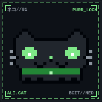

<div align="center">




<!--START_SECTION:banner-->
```text
  ___   _     _____      _   _ ______ 
 / _ \ | |   |_   _|    | | | ||  ___|
/ /_\ \| |     | |______| |_| || |_   
|  _  || |     | |______|  _  ||  _|  
| | | || |_____| |_     | | | || |    
\_| |_/\_____/\___/     \_| |_/\_|    
                                      
                                      
```
<!--END_SECTION:banner-->

<a href="https://git.io/typing-svg"></a>


</div>

### `$ neofetch`

<!--START_SECTION:neofetch-->
```text
ali@github
----------
Host      : NED University, Karachi
Class     : BCIT
Guild     : hkh.agency
Side quest: Notebloom
Uptime    : 417 days on GitHub
Repos     : 30
Stars     : 1
Followers : 12
Last push : 2h ago
Updated   : 2026-10-31
```
<!--END_SECTION:neofetch-->

### `> level.exe`

<!--START_SECTION:xp-->
```text
LVL 10 [████░░░░░░░░░░░░░░░░] 1701 / 2000 XP
CLASS: HACKER
```
<!--END_SECTION:xp-->

<div align="center"></div>

### `>be me`

```text
>be me
>CS student in Karachi
>"just one more commit then sleep"
>it is 4am
>the bug was a missing semicolon
>mfw
```

### `/dev/null/ - random` (dev confessionals)

```text
Anonymous 10/31/26(Sat)21:20:11 No.31415926
>ali pushed to main
>commit message: "fix"
>commit message: "fix2"
>commit message: "fix FINAL"
>commit message: "fix FINAL real"

Anonymous 10/31/26(Sat)21:20:48 No.31415927
>>31415926
it compiled once on his machine, that's all the QA we need

Anonymous 10/31/26(Sat)21:21:30 No.31415928
>>31415927
works on my machine is a valid deployment strategy
```

<details>
<summary><code>[ CLASSIFIED FILES - click if you dare ]</code></summary>

```text
ACCESS GRANTED
-----------------------------------------
secret #1 : this profile was built at 9pm because boredom is a feature
secret #2 : the best debugger is a night walk
secret #3 : try the terminal site, type `sudo rm -rf /`
-----------------------------------------
```

</details>

<div align="center"></div>

### `/inventory/`

<div align="center">


</div>

### `/stats/`

<div align="center">


</div>

<!--
OPTIONAL CARDS (uncomment after you set them up):

LeetCode card (replace YOUR_LEETCODE_USERNAME):


WakaTime weekly stats (needs a WakaTime account + the athul/waka-readme action):
(add WAKATIME start/end marker comments here)

Spotify now playing (needs https://spotify-github-profile.kittinunf.com setup):

-->

### `/quote.txt/`

<div align="center">


</div>

### `/recent_pushes/`

<!--START_SECTION:repos-->
| Repository | Tech Stack | Last Active |
| :--- | :---: | :---: |
| [**HackInsight**](https://github.com/Ali-HF/HackInsight) | `Python` | 2h ago |
| [**ned-3d-dsa-visualizer**](https://github.com/Ali-HF/ned-3d-dsa-visualizer) | `TypeScript` | 1d ago |
| [**ned-portal-attendance-tracker**](https://github.com/Ali-HF/ned-portal-attendance-tracker) | `JavaScript` | 10d ago |
| [**ned-prospectus-rag**](https://github.com/Ali-HF/ned-prospectus-rag) | `Python` | 17d ago |
| [**github-pages-demo**](https://github.com/Ali-HF/github-pages-demo) | `CSS` | 17d ago |
| [**fart-simulator**](https://github.com/Ali-HF/fart-simulator) | `TypeScript` | 21d ago |
<!--END_SECTION:repos-->

### `/quests/` - active & completed builds

| Status | Quest / Repository | Tech Stack | Brief / Log |
| :---: | :--- | :---: | :--- |
| **`[✔]`** | [**Memory-Allocator**](https://github.com/Ali-HF/Memory-Allocator) | `C++` | Custom memory allocators engineered to beat standard heap |
| **`[✔]`** | [**webrtc-call-app**](https://github.com/Ali-HF/webrtc-call-app) | `Node.js` `WebRTC` | Peer-to-peer real-time video calling via Socket.io |
| **`[✔]`** | [**PF**](https://github.com/Ali-HF/PF) | `C` | First-semester programming fundamentals grind & core algorithms |
| **`[▶]`** | [**ned-3d-dsa-visualizer**](https://github.com/Ali-HF/ned-3d-dsa-visualizer) | `TypeScript` `3D` | Interactive 3D visualizer for data structures & algorithms |
| **`[▶]`** | [**ned-portal-attendance-tracker**](https://github.com/Ali-HF/ned-portal-attendance-tracker) | `JavaScript` | Automated attendance calculator tailored for NED portal |
| **`[▶]`** | [**LeetCode-Submissions**](https://github.com/Ali-HF/LeetCode-Submissions) | `C++` | Daily DSA solutions, optimizations, and algorithmic patterns |
| **`[▶]`** | [**quick-ledger**](https://github.com/Ali-HF/quick-ledger) | `Fullstack` | Fast minimal accounting & ledger engine [in progress] |
| **`[ ]`** | `world domination` | `AI / Vibes` | Loading 0%... |


<div align="center"></div>

### `/game.exe/` - play tic-tac-toe against my bot

Click a square. It opens a pre-filled issue, just press **Submit new issue**. A GitHub Action plays your move and the bot's reply within about a minute.

<!--START_SECTION:ttt-->
| &nbsp; | &nbsp; | &nbsp; |
|:-:|:-:|:-:|
| [⬜](https://github.com/Ali-HF/Ali-HF/issues/new?labels=ttt&body=Just+press+Submit+new+issue.+The+bot+does+the+rest.&title=ttt%7Cmove%7C0) | [⬜](https://github.com/Ali-HF/Ali-HF/issues/new?labels=ttt&body=Just+press+Submit+new+issue.+The+bot+does+the+rest.&title=ttt%7Cmove%7C1) | [⬜](https://github.com/Ali-HF/Ali-HF/issues/new?labels=ttt&body=Just+press+Submit+new+issue.+The+bot+does+the+rest.&title=ttt%7Cmove%7C2) |
| [⬜](https://github.com/Ali-HF/Ali-HF/issues/new?labels=ttt&body=Just+press+Submit+new+issue.+The+bot+does+the+rest.&title=ttt%7Cmove%7C3) | [⬜](https://github.com/Ali-HF/Ali-HF/issues/new?labels=ttt&body=Just+press+Submit+new+issue.+The+bot+does+the+rest.&title=ttt%7Cmove%7C4) | [⬜](https://github.com/Ali-HF/Ali-HF/issues/new?labels=ttt&body=Just+press+Submit+new+issue.+The+bot+does+the+rest.&title=ttt%7Cmove%7C5) |
| [⬜](https://github.com/Ali-HF/Ali-HF/issues/new?labels=ttt&body=Just+press+Submit+new+issue.+The+bot+does+the+rest.&title=ttt%7Cmove%7C6) | [⬜](https://github.com/Ali-HF/Ali-HF/issues/new?labels=ttt&body=Just+press+Submit+new+issue.+The+bot+does+the+rest.&title=ttt%7Cmove%7C7) | [⬜](https://github.com/Ali-HF/Ali-HF/issues/new?labels=ttt&body=Just+press+Submit+new+issue.+The+bot+does+the+rest.&title=ttt%7Cmove%7C8) |

**your move (you are ❌)**<br>score: you ❌ 0 | bot ⭕ 0 | draws 0 · [reset board](https://github.com/Ali-HF/Ali-HF/issues/new?labels=ttt&body=Just+press+Submit+new+issue.+The+bot+does+the+rest.&title=ttt%7Cnew%7C0)
<!--END_SECTION:ttt-->

### `/wall/` - leave graffiti on the guestbook

[**>> WRITE ON THE WALL <<**](https://github.com/Ali-HF/Ali-HF/issues/new?title=guestbook&body=Write+your+message+here+%28140+chars%2C+no+links%29%2C+then+press+Submit.)

<!--START_SECTION:guestbook-->
```text
The wall is empty. Be the first anon.
```
<!--END_SECTION:guestbook-->

### `/snake.exe/`

<div align="center">

<picture>
  <source media="(prefers-color-scheme: dark)" srcset="https://raw.githubusercontent.com/Ali-HF/Ali-HF/output/github-snake-dark.svg" />
  <source media="(prefers-color-scheme: light)" srcset="https://raw.githubusercontent.com/Ali-HF/Ali-HF/output/github-snake.svg" />
  
</picture>

</div>

### `/trophies/`

<div align="center">


</div>

### `/contact/`

<div align="center">

[](https://ali-hf.github.io)
[](https://www.linkedin.com/in/ali-hasan-897516384)
[](mailto:hf.alihasan0@gmail.com)

```text
  ∧＿∧
 (｡･ω･｡)つ━☆・*。
 ⊂   ノ    ・゜+.
  しーＪ   °。+ *´¨)
           .· ´¸.·*´¨) ¸.·*¨)
            (¸.·´ (¸.·'* ☆   thx for visiting, anon
```


</div>
