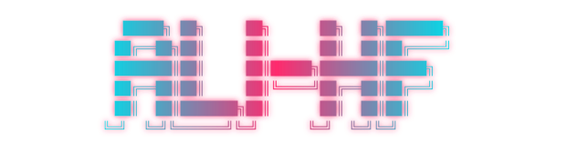
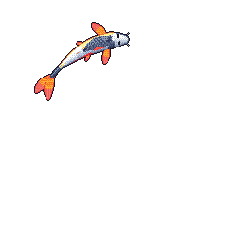

<!-- banner starts -->

<!-- banner ends -->

Currently studying BCIT at NED University in Karachi toward becoming an AI engineer, and running Notebloom (a stationery brand). Connect on [LinkedIn](https://www.linkedin.com/in/ali-hasan-897516384), check out my [terminal portfolio](https://ali-hf.github.io), or email [hf.alihasan0@gmail.com](mailto:hf.alihasan0@gmail.com).

<table><tr><td valign="top" width="33%">

### Recent pushes
<!-- recent_pushes starts -->
[HackInsight](https://github.com/Ali-HF/HackInsight) - 4 hours ago

[ned-3d-dsa-visualizer](https://github.com/Ali-HF/ned-3d-dsa-visualizer) - 4 hours ago

[blog](https://github.com/Ali-HF/blog) - 2 days ago

[google-forms-test-filler](https://github.com/Ali-HF/google-forms-test-filler) - 3 days ago

[personal-fitness-app](https://github.com/Ali-HF/personal-fitness-app) - 4 days ago
<!-- recent_pushes ends -->
More [recent pushes](https://github.com/Ali-HF?tab=repositories)
</td><td valign="top" width="34%">

### On my blog
<!-- writing starts -->
*Coming soon — follow updates via [terminal portfolio](https://ali-hf.github.io).*
<!-- writing ends -->
More on [ali-hf.github.io](https://ali-hf.github.io)
</td><td valign="top" width="33%">

### TIL
<!-- tils starts -->
[Using HTML comment markers to rewrite a README](til/2026-11-07-readme-markers.md) - 2026-11-07
<!-- tils ends -->
More in [til/](til/)
</td></tr></table>
